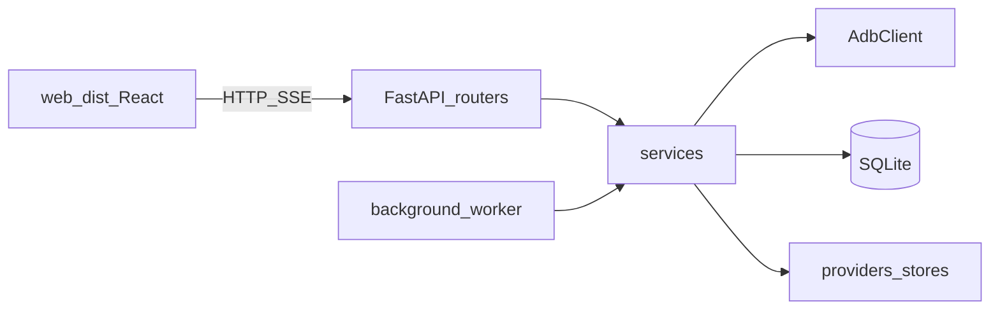

# Архитектура apk_updater

## Поток данных

1. **Discovery / pair** — сеть, QR, connect → реестр `devices` + in-memory transports.
2. **Inventory** — `apps.list_packages` по ADB → кеш `AppState` + опционально `device_ui_cache`.
3. **Update check** — сторы (RuStore, APKPure, Aptoide, F-Droid) → `UpdateInfo` / `remotes_ui_cache`.
4. **Install** — скачать APK в `data/cache/apk`, `adb install`, история / pending offline.
5. **Background** — периодический check (`force` по расписанию) и auto-install по настройкам.

## Ключевые модули

| Модуль | Роль |
|--------|------|
| `app/api/app_factory.py` | Сборка FastAPI, статика `web/dist` |
| `app/api/state.py` | Apps/updates cache, job lock, настройки |
| `app/services/devices.py` | Реестр, prepare_online, профили |
| `app/services/batch_jobs.py` | check-batch, install-all, payload приложений |
| `app/services/updates.py` | Сравнение версий, выбор стора |
| `app/services/background.py` | Таймеры фона + запись в updates.log |
| `app/services/package_sources.py` | Предпочтительный стор (БД + маркер на устройстве) |
| `app/services/update_ignores.py` | «Не обновлять» per device+package |
| `app/adb/client.py` | Все shell/push/install/sound |

## БД (кратко)

Файл: `data/apk_updater.db`, DDL: `app/db/schema.sql` (на старте `Database.migrate()` = `executescript`).

- `devices` — реестр + профиль (model, sdk, preview_path, device_uid…)
- `settings` — key/value (интервалы фона, флаги сторов…)
- `apk_cache`, `install_history`, `pending_jobs`
- `device_ui_cache`, `remotes_ui_cache` — переживают рестарт процесса
- `package_sources`, `update_ignores`
- `bg_activity_log` — журнал для UI настроек

## UI-зоны

- Сайдбар: устройства online, **проверить/установить всё (все)**
- Карточка устройства: **проверить/установить** только выбранное; модалка `i` (свойства, alarm/timer, скрин)
- Список приложений: Обновить / `i` (ignore внутри модалки)

## Связанные доки

- [API-MAP.md](API-MAP.md) — endpoints
- [DATA-AND-OPS.md](DATA-AND-OPS.md) — data/, bat, деплой
